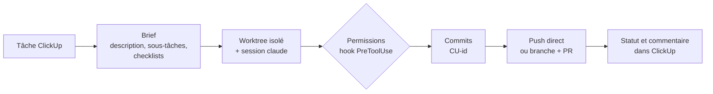

<p align="center">
  
</p>

<h1 align="center">Codbot</h1>

<p align="center">
  <strong>Coche une tâche ClickUp. Claude Code la code, la commite et la livre.</strong><br>
  Application de bureau qui relie tes tâches ClickUp aux agents Claude Code, du brief au push.
</p>

<p align="center">
  <a href="https://github.com/My5t3r10us/codbot/releases/latest"></a>
  
  
  
</p>

<p align="center">
  <a href="#installation">Installation</a> ·
  <a href="#premier-réglage">Premier réglage</a> ·
  <a href="#utilisation">Utilisation</a> ·
  <a href="#fonctionnalités">Fonctionnalités</a> ·
  <a href="#développement">Développement</a>
</p>

---

## Pourquoi Codbot

Les tâches vivent dans ClickUp, le travail se fait dans des sessions Claude Code, et rien ne relie
les deux. Sans outil, il faut rédiger le brief de chaque agent à la main, repérer la session qui
attend une réponse, reporter le résultat dans ClickUp, puis lancer la tâche suivante soi-même.

Codbot s'en charge. Il construit le brief depuis la tâche, lance `claude` dans un worktree isolé,
gère les permissions, livre les commits (push direct ou pull request) et fait avancer le statut
ClickUp à partir d'événements vérifiables. Il peut enchaîner une file de tâches pendant des heures,
sans surveillance.

- **ClickUp reste la source de vérité** : Codbot lit les tâches, change leur statut et les commente.
- **Ton abonnement Claude** : Codbot pilote le CLI `claude` avec tes skills, rules, `CLAUDE.md`
  et serveurs MCP. Aucun appel payant à l'API Anthropic.
- **Git propre** : commit direct sur la branche principale pour une petite tâche, branche et PR
  sinon. La règle est appliquée par l'app, pas laissée à l'agent.

## Comment ça marche



1. Tu coches une ou plusieurs tâches et tu assignes un agent.
2. Codbot crée un worktree sur `origin/<branche>` (dans `<parent du repo>\.codbot-worktrees\`) et
   lance une session `claude` avec un brief tiré de la tâche.
3. Chaque appel d'outil passe par un hook : lectures et éditions dans le worktree sont autorisées
   d'office, le reste attend ta décision ou la liste blanche du projet.
4. À la fin du tour, les commits sont rebasés et poussés, ou partent sur une branche avec une PR.
5. La tâche passe à « Terminé » ou « En revue » avec un commentaire (commits, lien GitHub, résumé).
   En cas de conflit, de vérification ratée ou d'erreur, elle passe à « Bloqué » avec la raison.

## Installation

### Prérequis

| Outil | Pourquoi |
|---|---|
| Windows 10 ou 11 (x64) | Codbot est une application Windows. |
| [Claude Code](https://docs.claude.com/en/docs/claude-code) (`claude`), connecté à ton abonnement | C'est lui qui fait le travail. |
| [Git](https://git-scm.com/) | Worktrees, commits, rebase et push. |
| [GitHub CLI](https://cli.github.com/) (`gh`), connecté | Ouverture et suivi des pull requests. |
| Un jeton API personnel ClickUp | Lecture des tâches, statuts et commentaires. |
| Des repos locaux avec un remote `origin` | Là où les agents travaillent. |

### Installer

1. Télécharge `Codbot_<version>_x64-setup.exe` depuis la
   [dernière release](https://github.com/My5t3r10us/codbot/releases/latest).
2. Lance l'installeur. Il installe Codbot pour l'utilisateur courant, sans droits administrateur,
   et installe WebView2 s'il manque (il est déjà présent sur Windows 11).

L'installeur n'a pas de signature de code Windows : à la première installation, SmartScreen
affiche un avertissement (« Informations complémentaires » puis « Exécuter quand même »).

Les mises à jour sont automatiques : Codbot vérifie les releases au démarrage, affiche
« Réglages ⬆ » quand une version est disponible, et contrôle la signature du paquet avant de
l'installer.

Au démarrage, un **diagnostic** vérifie `claude`, `git`, `gh` et le jeton ClickUp. Si quelque chose
manque, la barre affiche « Réglages ⚠ » et la carte Diagnostic dit quoi corriger.

## Premier réglage

1. **Réglages → Jeton API ClickUp** : colle ton jeton personnel (ClickUp → Réglages → Apps). Il est
   stocké dans le Gestionnaire d'identification Windows (service `codbot`), jamais en clair.
2. **Espace de travail** : choisi automatiquement s'il n'y en a qu'un.
3. **Projets** : associe une liste ClickUp à un repo local qui a un remote `origin`, et indique sa
   branche principale. Tu peux aussi définir une commande de vérification et la liste blanche des
   permissions du projet.
4. **Correspondance des statuts** : pour chaque événement (run démarré, question en attente,
   branche poussée ou PR ouverte, push direct ou PR mergée, échec), le statut ClickUp à appliquer.
5. **Mode des statuts** : automatique (Codbot change le statut et commente) ou manuel (bandeau de
   suggestions). Le mode peut aussi être choisi à chaque lancement.
6. **Modèles et raisonnement** : choix automatique du modèle et de l'effort, modèle fixe, ou réglage
   par défaut de Claude Code.

Plusieurs PC ? Exporte tes réglages en JSON et importe-les sur l'autre machine (voir
[Plusieurs PC](#plusieurs-pc)).

## Utilisation

### Lancer un agent

1. Onglet **Tâches** : filtre tes tâches (recherche, assignées à moi, échéance, terminées) et coche
   celles à traiter. Cocher une tâche coche ses sous-tâches.
2. **Assigner un agent** : choisis le mode, la stratégie git, le modèle et l'effort. Le brief est
   prévisualisé et modifiable.
3. **Lancer maintenant**, ou **Ajouter à la file** pour un traitement sans surveillance.

### Suivre et répondre

L'onglet **Runs** affiche le journal de chaque session. Tu peux répondre à l'agent, valider une
permission, arrêter, reprendre (`--resume`), retenter le push ou abandonner. « Ouvrir dans un
terminal » rouvre la session avec `claude --resume` dans son worktree pour reprendre la main ;
« Livrer les commits » livre ensuite le travail fait à la main.

Une notification part quand un agent attend une réponse ou une permission, quand un travail est
poussé, qu'une PR est prête ou mergée, qu'un run est bloqué, et à la fin de la file. Revenir dans
l'app après une notification ouvre le run concerné.

### Piloter depuis ClickUp avec des tags

| Tag | Effet |
|---|---|
| `small` | Propose le commit direct sur la branche principale plutôt qu'une branche. |
| `modele:opus`, `model:sonnet`… | Force le modèle utilisé. |
| `effort:high`… | Force l'effort de raisonnement. |
| `taille:petite`, `taille:moyenne`, `taille:grande` | Force la taille estimée de la tâche. |

## Fonctionnalités

### Modes de run et stratégie git

- **Mode séparé** : un agent, un worktree et une branche par tâche, en parallèle.
- **Mode groupé** : un agent et un worktree pour plusieurs tâches, avec un commit par tâche portant
  son ID `[CU-<id>]`. Une tâche n'avance que si un commit porte son ID.
- **Direct-main** : rebase sur `origin/<branche>` puis push. Un seul run de ce type à la fois par
  repo. En cas de conflit, le travail part sur une branche avec une PR plutôt que d'être bloqué.
- **Branche** : branche `cu/<id>-<titre>`, push et PR ouverte avec `gh` (tâches liées et résumé de
  l'agent). Un message à l'agent pendant la revue relance la session et met la PR à jour.
- **Règle imposée** : plusieurs tâches en mode séparé, ou un run déjà actif sur le repo, imposent
  une branche. Sinon le choix est libre.
- **Merge détecté** toutes les 60 s : PR mergée → tâches terminées, worktree et branche locale
  supprimés ; PR fermée sans merge → run bloqué. Hors GitHub, le merge est détecté avec git.

### Choix automatique du modèle

Chaque tâche est classée par type et par taille, par des règles locales ou un triage rapide avec
Haiku. Une matrice de recommandation, modifiable dans les réglages, en déduit le modèle et l'effort,
bornés aux modèles que tu autorises. Le choix reste modifiable au lancement et est conservé dans
la file.

### File sans surveillance

- **Onglet File** : ordre par glisser-déposer, Démarrer / Arrêter, concurrence réglable (2 agents
  par défaut). Les règles git par repo sont respectées.
- **Liste blanche par projet** : sans toi, chaque permission est décidée par des motifs comme
  `Bash(npm test*)` ou `mcp__github__*`. Une commande enchaînée n'est autorisée que si chaque partie
  l'est. `git push` est toujours refusé à l'agent : c'est Codbot qui livre.
- **Délai de réponse** (10 min par défaut) : une question sans réponse passe le run en « Bloqué »
  avec la question en commentaire ClickUp, et la file continue.
- **Limite d'usage** : le run se met en pause au lieu d'échouer, la file attend l'heure de
  réinitialisation puis reprend. L'usage de l'abonnement (fenêtres 5 h et 7 j) est affiché dans la
  barre du haut.
- **Anti-veille** tant qu'une session tourne, et **rapport** de fin de file (terminés, en revue,
  bloqués, durées, liens PR).

### Sécurité

- Permissions contrôlées par un hook `PreToolUse`, avec un jeton propre à chaque run, renouvelé à
  chaque session et révoqué à la fin.
- Sans réponse au bout de 60 s en mode interactif, la tâche passe en « Bloqué » et une notification
  part.
- **Secrets masqués** dans les commentaires ClickUp, les PR et le journal : jetons GitHub, ClickUp,
  Anthropic et AWS, JWT, clés privées, mots de passe d'URL, affectations `CLE=valeur` sensibles
  ([redact.ts](src/redact.ts)).
- Jeton ClickUp rangé dans le Gestionnaire d'identification Windows.

### Plusieurs PC

- **Verrou** : un PC qui prend une tâche lui pose le tag ClickUp `codbot-<nom-du-pc>` et le retire à
  la fin. Les autres PC ne peuvent pas la lancer, et la file la saute. « Libérer » retire un verrou
  périmé.
- **Export / import des réglages** en JSON : espace de travail, statuts, modèles, file, projets et
  listes blanches. Ni le jeton ClickUp ni les chemins locaux des repos ne sont exportés.
- **Une seule instance** par PC : relancer l'app ramène la fenêtre existante.

## Développement

### Stack

- [Tauri v2](https://tauri.app/). Le cœur Rust se limite à ce qu'aucun plugin ne couvre : serveur
  local des hooks, trousseau Windows, anti-veille, ouverture du terminal.
- TypeScript pour la logique métier (ClickUp, orchestration des sessions `claude`, git, file),
  avec les plugins officiels `shell`, `http`, `sql`, `notification`, `updater` et `single-instance`.
- React 19, Vite et Tailwind CSS pour l'interface.
- SQLite (via `tauri-plugin-sql`) pour les runs, la file et les réglages, avec des migrations
  versionnées.

### Lancer en local

Prérequis supplémentaires : Rust (toolchain MSVC) et Node.js 22.5 ou plus récent (les tests
utilisent `node:sqlite`).

```bash
npm install
npm run tauri dev
```

Le serveur Vite écoute sur le port 1430.

### Tests

```bash
npm test
```

- `tests/*.test.ts` (Vitest) : règles métier pures ([rules.ts](src/rules.ts) : stratégie git, file,
  brief, commits, limite et usage, échéances), choix du modèle, liste blanche, masquage des secrets,
  verrou, noms git, et toutes les migrations SQL appliquées sur une base en mémoire.
- `tests/git.integration.test.ts` : vraies séquences git sur des repos temporaires (commit direct,
  conflit de rebase et repli sur une branche, branche puis merge).
- Côté Rust : `cargo test --lib` dans `src-tauri` (jeton de hook par run, arguments du terminal).

### Structure

```text
src/                   logique métier (ClickUp, sessions claude, git, gh, file, règles, verrou…)
src/pages/             onglets Tâches, Runs, Projets et Réglages
src-tauri/src/         côté Rust : serveur des hooks, trousseau, anti-veille, terminal
src-tauri/migrations/  schéma SQLite
tests/                 tests Vitest et intégration git
scripts/release.mjs    publication d'une version
docs/assets/           images du README
```

### Construire l'installeur

```bash
npm run tauri build
```

L'installeur est produit dans
`src-tauri\target\release\bundle\nsis\Codbot_<version>_x64-setup.exe`.

### Publier une version

1. Incrémente `version` dans `src-tauri/tauri.conf.json`.
2. Lance le script de release avec la clé de signature de l'updater dans l'environnement
   (`TAURI_SIGNING_PRIVATE_KEY`, `TAURI_SIGNING_PRIVATE_KEY_PASSWORD`) et `gh` connecté. Pour le
   mainteneur, la clé vient d'Infisical :

   ```bash
   infisical run --env=dev -- npm run release -- --notes "Ce qui change"
   ```

Le script construit l'installeur signé, écrit `latest.json` et crée la release `v<version>`.
`--skip-build` republie les fichiers déjà construits. L'app lit
`https://github.com/My5t3r10us/codbot/releases/latest/download/latest.json` et vérifie le paquet
avec la clé publique de `tauri.conf.json`.

## Documentation

La spécification produit complète (concepts, parcours, règles de statut et de git) est dans
[SPEC.md](SPEC.md).
